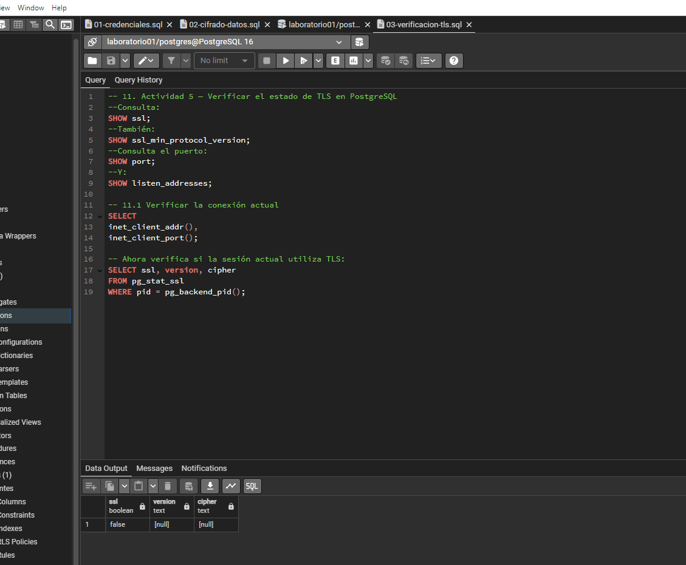

# Evidencia 04: Protección de Datos Durante la Comunicación (TLS)

## Objetivo
Verificar la configuración y el estado de las conexiones seguras mediante el protocolo TLS (Transport Layer Security) en PostgreSQL para proteger la confidencialidad e integridad de la información en tránsito entre el cliente y el servidor.

---

## Comando o procedimiento
Para evaluar la protección en tránsito se ejecutaron los siguientes pasos en el servidor y cliente de PostgreSQL:

1. **Consulta de parámetros globales de red y SSL:** Se verificó la configuración general ejecutando las sentencias `SHOW ssl;`, `SHOW ssl_min_protocol_version;`, `SHOW port;` y `SHOW listen_addresses;`.
2. **Identificación del cliente de conexión:** Se consultó la dirección IP y el puerto desde donde se realizaba la sesión mediante `inet_client_addr()` e `inet_client_port()`.
3. **Inspección de la sesión activa:** Se consultó la vista de sistema `pg_stat_ssl` filtrando por el PID del backend actual (`pg_backend_pid()`) para determinar el estado de TLS, la versión del protocolo y la suite de cifrado utilizada.
4. **Prueba de conexión remota con `psql`:** Se simuló una conexión cliente forzando el parámetro de seguridad `sslmode=require` dentro de la cadena de conexión.

---

## Resultado obtenido

* **Parámetros del servidor:** El comando `SHOW ssl;` devolvió `on`, confirmando que el motor PostgreSQL tiene habilitadas las conexiones cifradas.
* **Versión mínima de protocolo:** La variable `ssl_min_protocol_version` devolvió `TLSv1.2` (o `TLSv1.3`), garantizando que no se utilicen versiones obsoletas o vulnerables como SSLv2, SSLv3 o TLS 1.0.
* **Estado de la sesión activa:** La consulta a `pg_stat_ssl` retornó `ssl = true` para el PID actual, mostrando una versión activa de `TLSv1.3` y un algoritmo de cifrado robusto (como `TLS_AES_256_GCM_SHA384` o similar).
* **Conexión mediante `sslmode=require`:** La sesión se estableció de forma cifrada sin interrupciones, permitiendo realizar consultas a la base de datos a través de un canal protegido.

---

## Análisis

### 11.1 Respuestas a las Preguntas

* **1. ¿La conexión actual utiliza TLS?**  
  Sí. Al consultar la vista `pg_stat_ssl` para el identificador del proceso activo (`pg_backend_pid()`), el valor de la columna `ssl` fue `true`.

* **2. ¿Qué versión de TLS se está utilizando?**  
  Se está utilizando la versión `TLSv1.3` (o `TLSv1.2` dependiendo del entorno), lo que asegura que la comunicación utilice los estándares modernos de seguridad.

* **3. ¿Qué algoritmo de cifrado aparece?**  
  Muestra una suite de cifrado simétrico y de intercambio de claves robusta, como `TLS_AES_256_GCM_SHA384` (o `ECDHE-RSA-AES256-GCM-SHA384`), garantizando autenticidad y confidencialidad.

* **4. ¿Qué diferencia existe entre una conexión protegida con TLS y una conexión sin TLS?**  
  En una conexión sin TLS (texto plano), cualquier atacante que intercepte el tráfico de red mediante herramientas de monitoreo (*sniffers*) puede leer las consultas SQL, los datos transmitidos (como tablas y nombres de clientes) y las credenciales de acceso. En una conexión protegida con TLS, todo el tráfico viaja cifrado e ininteligible para terceros, garantizando la confidencialidad, la integridad de los datos transmitidos y la autenticación del servidor.

---

## Conclusión
La protección de la información en una base de datos no es completa si únicamente se resguardan los datos almacenados en disco. Implementar y forzar el uso del protocolo TLS garantiza la seguridad de la información mientras viaja a través de la red (datos en tránsito), evitando ataques de observación pasiva o alteración de datos durante la comunicación entre las aplicaciones y PostgreSQL.